# Device QA 2026-11-18 22:35

Device: RMX5313  ·  Android 16

| Level | Result | Moves / Par | Stars | Start | Win |
|---|---|---|---|---|---|
| 1 | WIN | 1 / 1 | 3 | 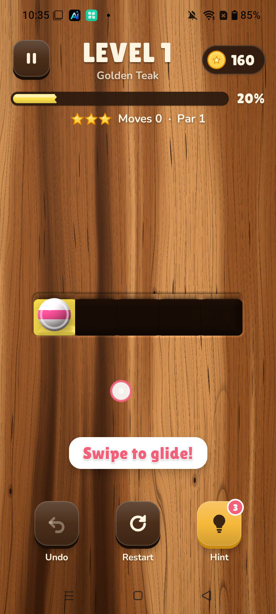 |  |
| 11 | WIN | 10 / 10 | 3 | 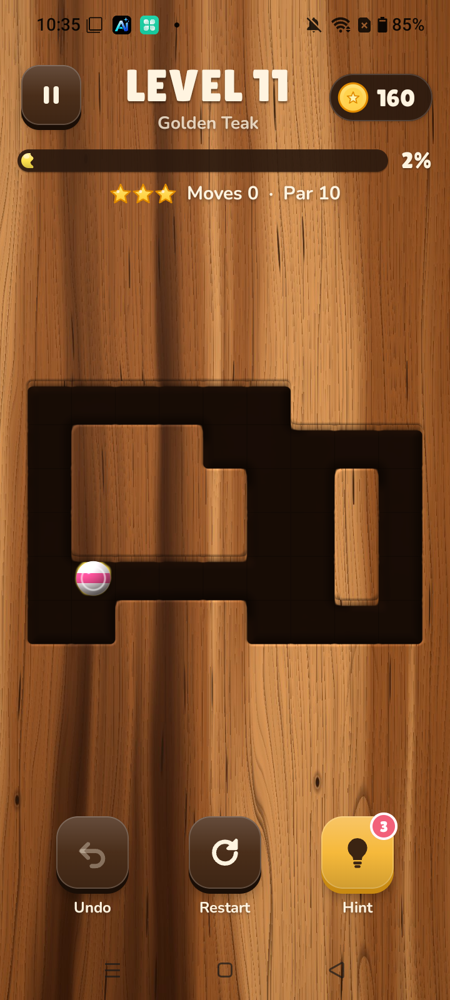 |  |
| 21 | WIN | 12 / 12 | 3 | 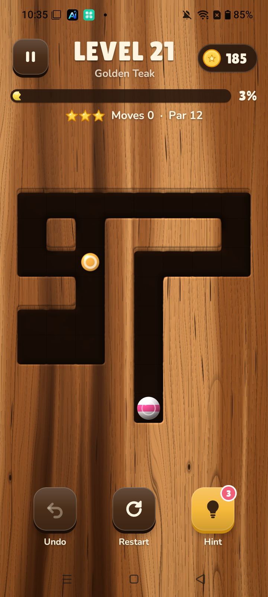 |  |
| 41 | WIN | 18 / 18 | 3 | 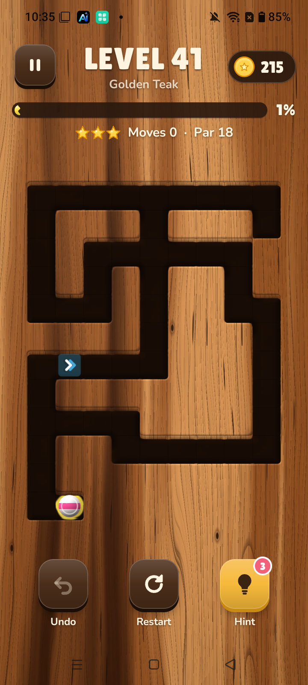 | 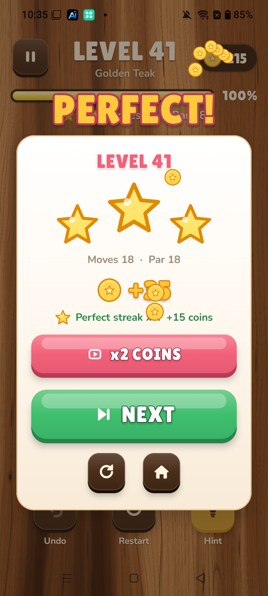 |
| 71 | WIN | 13 / 13 | 3 | 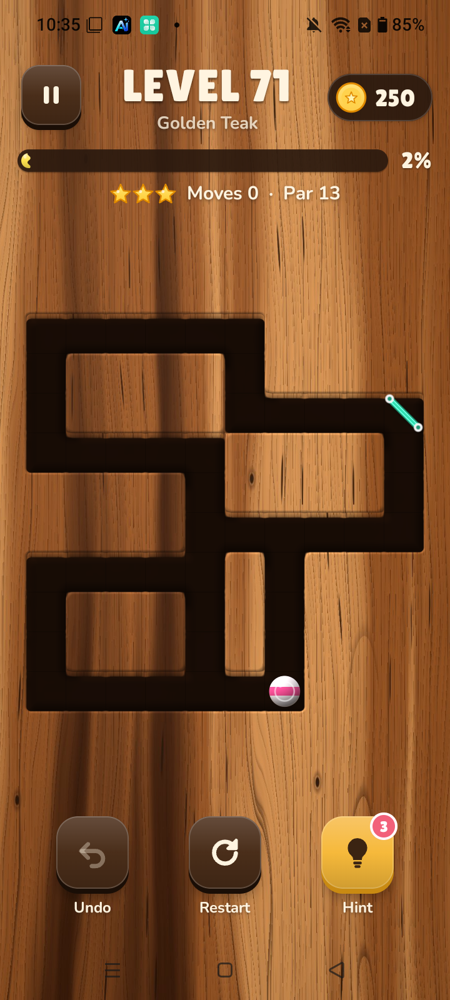 |  |
| 111 | WIN | 18 / 18 | 3 | 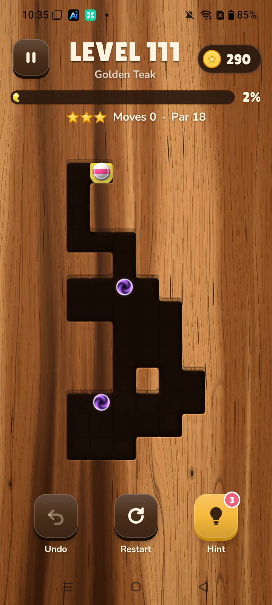 |  |
| 251 | WIN | 14 / 14 | 3 | 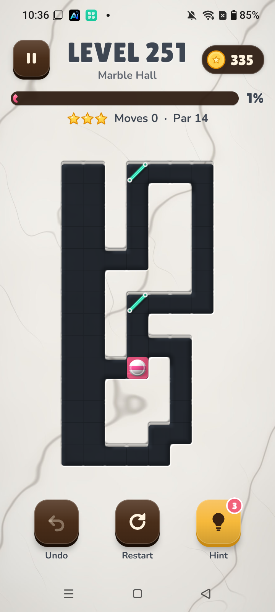 |  |
| 760 | WIN | 32 / 32 | 3 | 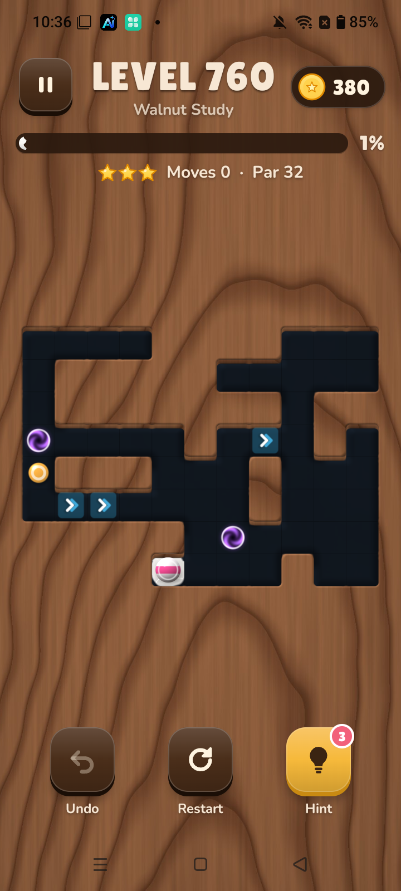 | 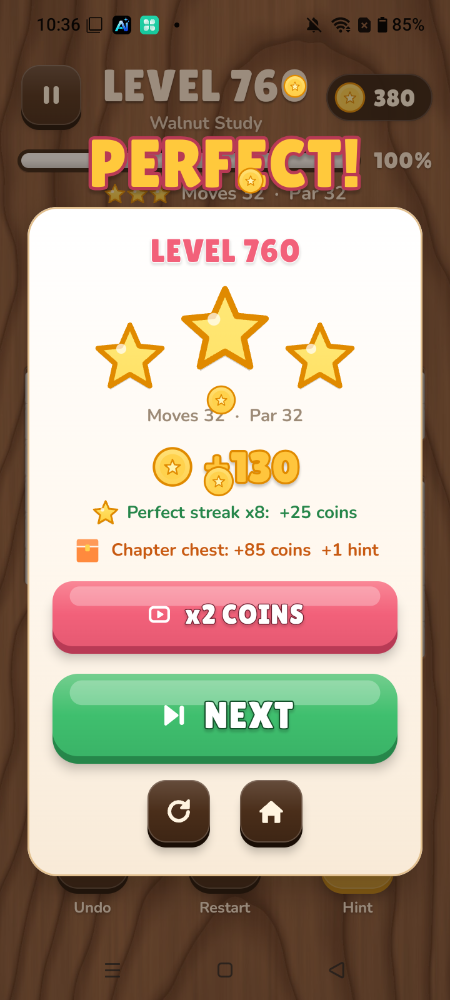 |
| 1001 | WIN | 22 / 22 | 3 | 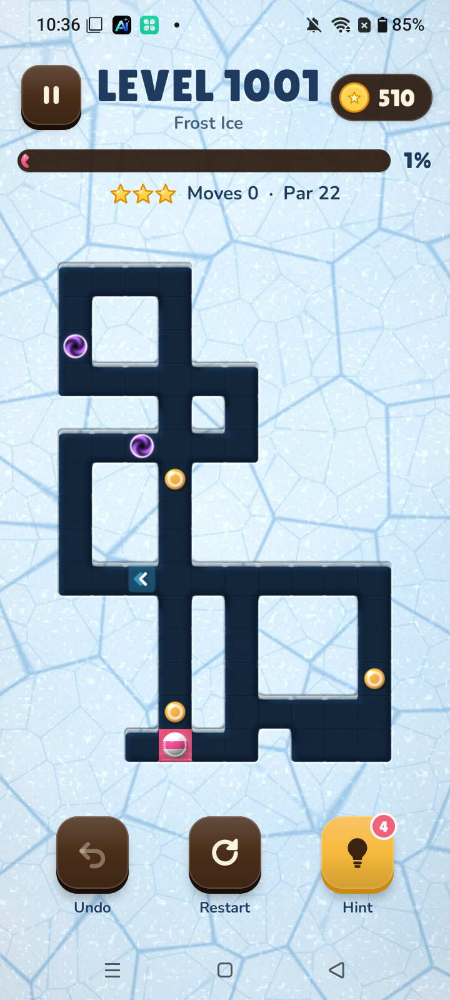 |  |
| 1251 | WIN | 28 / 28 | 3 | 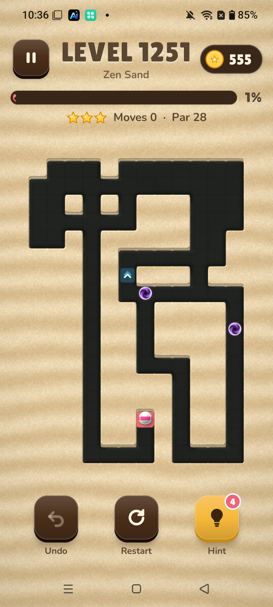 | 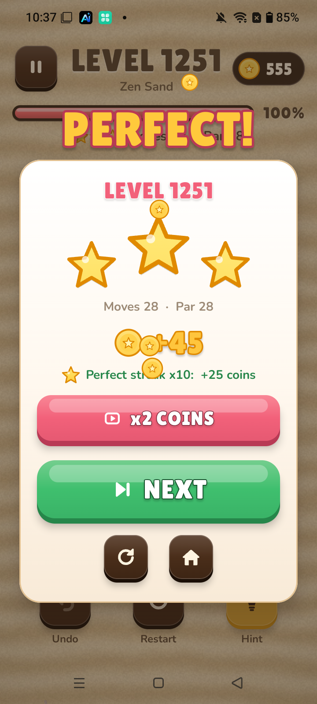 |
| 1501 | TIMEOUT | ? / ? | ? | 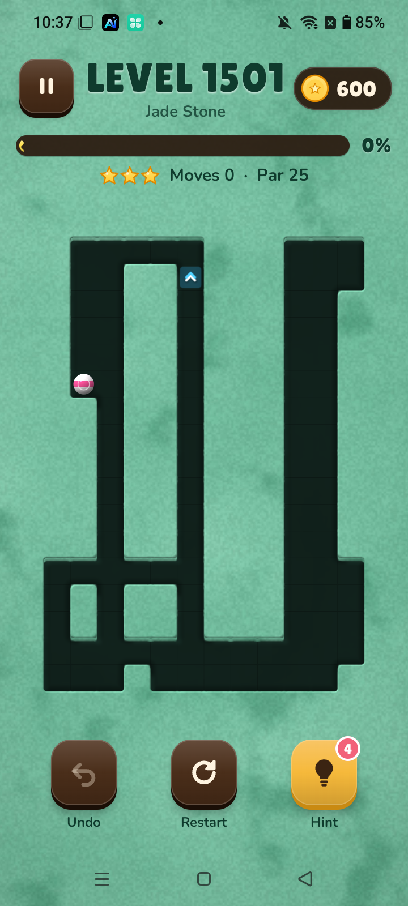 | 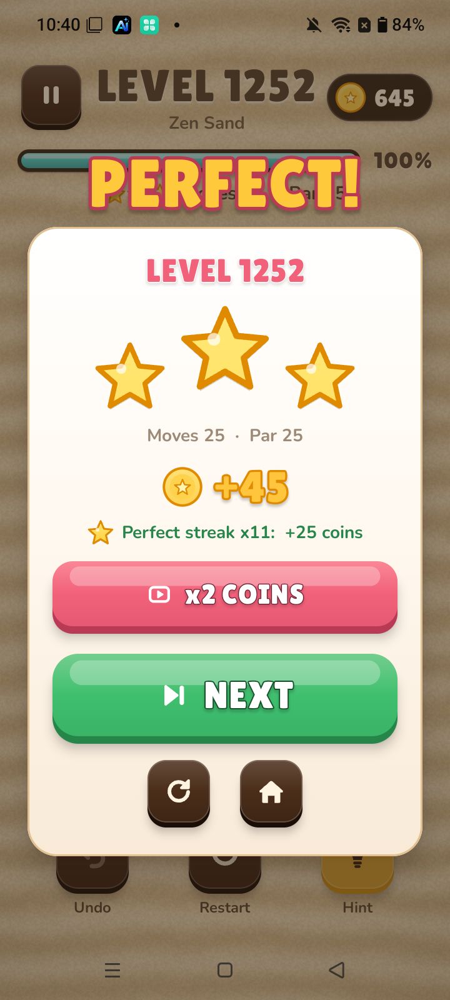 |
| 1751 | WIN | 24 / 24 | 3 | 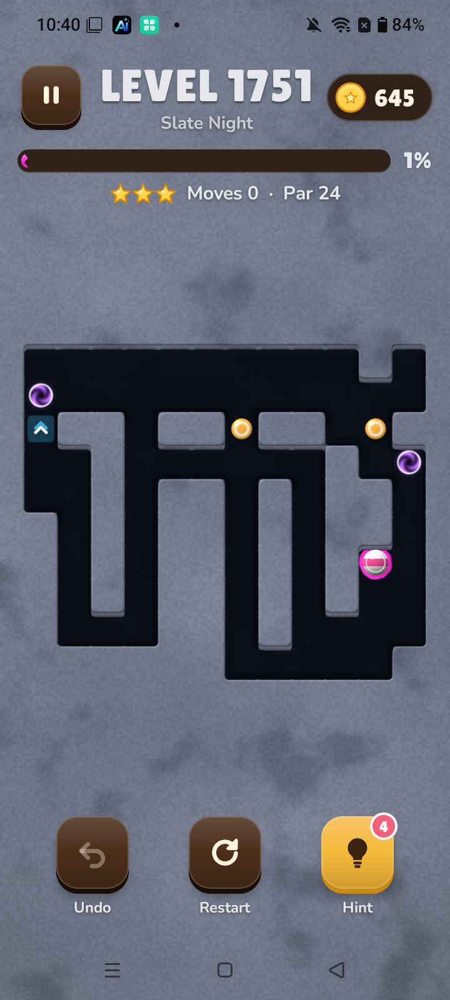 |  |
| 2001 | WIN | 37 / 37 | 3 | 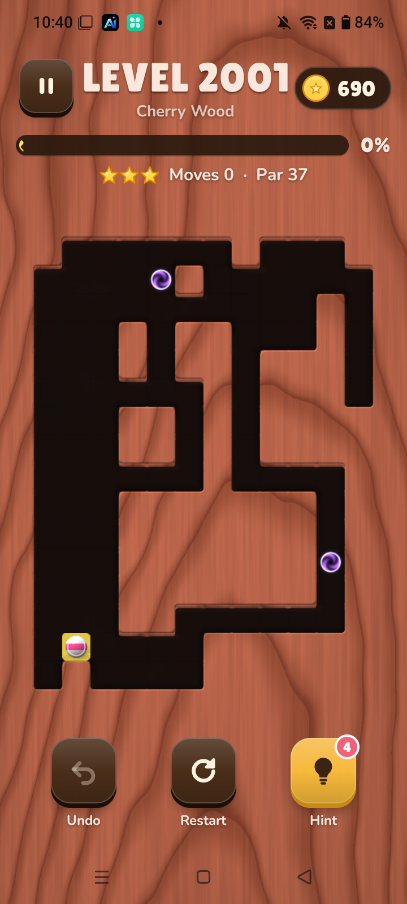 |  |
| 2251 | WIN | 36 / 36 | 3 | 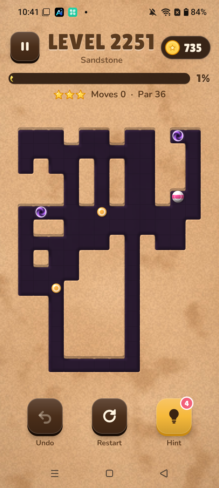 | 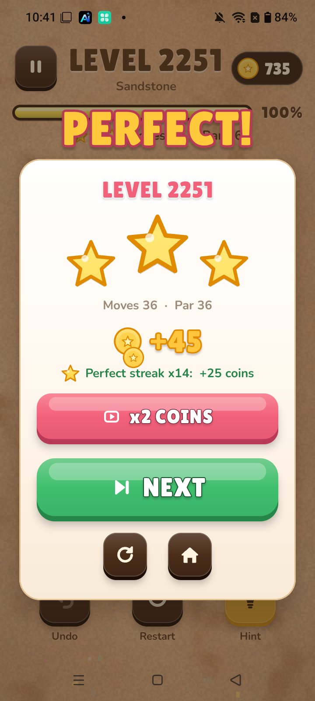 |
| 3500 | WIN | 29 / 29 | 3 | 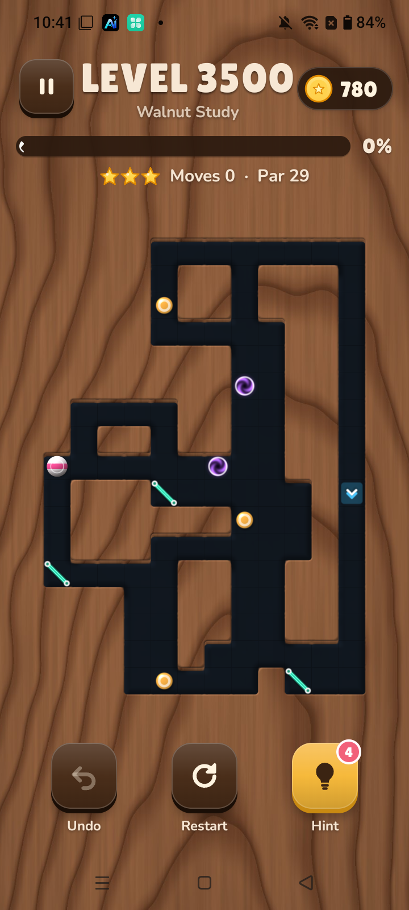 | 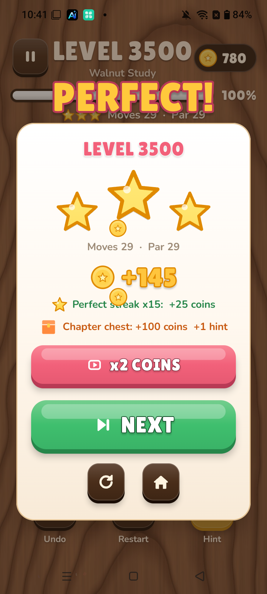 |
| 4999 | WIN | 49 / 49 | 3 | 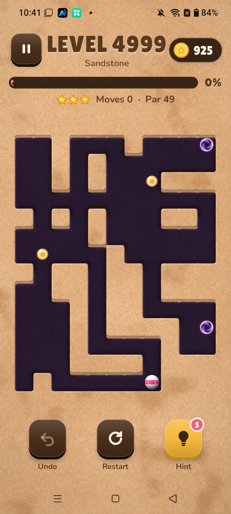 |  |

## Frame rate
```
  48 fps=60.0
  29 fps=60.1
  19 fps=59.9
   3 fps=58.3
   2 fps=58.8
   2 fps=58.0
   2 fps=57.8
   1 fps=60.2
```

Failures: 1
