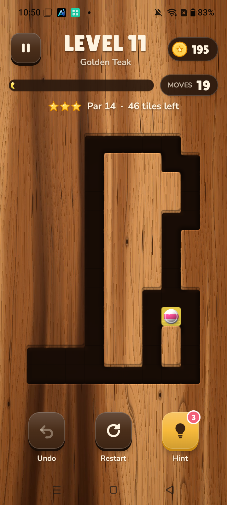
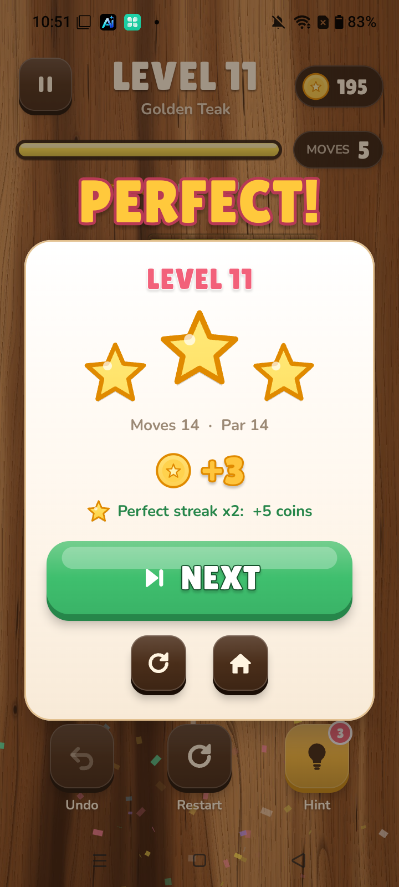
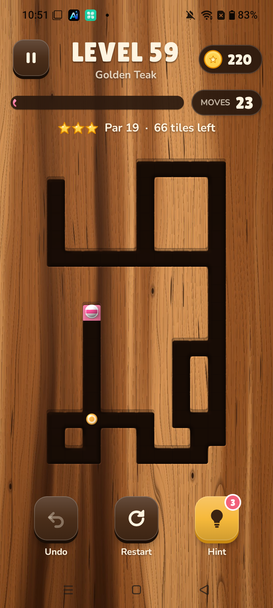
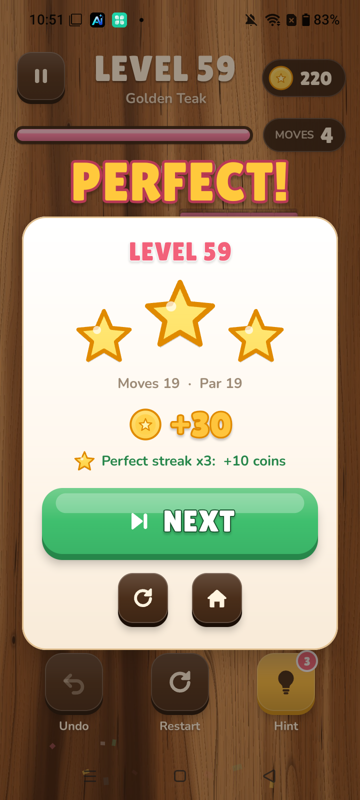
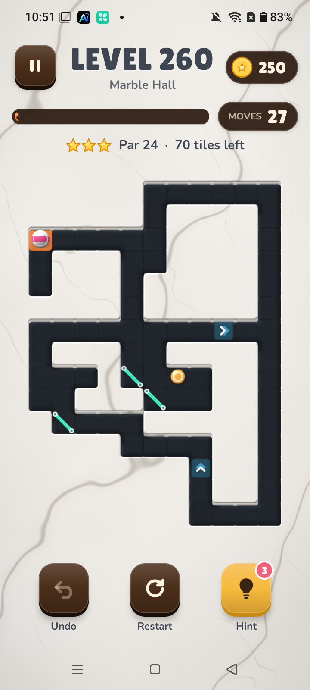
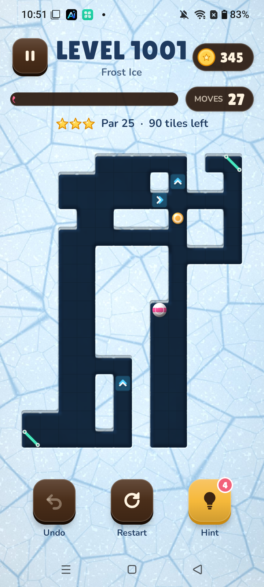
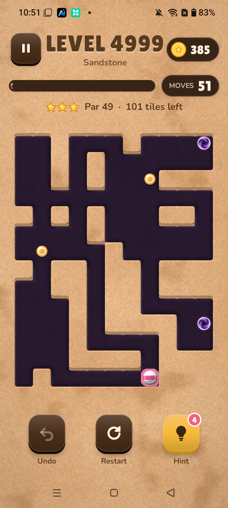
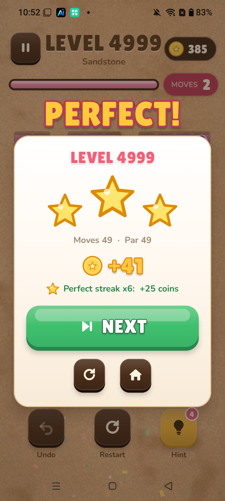

# Device QA 2026-11-18 22:50

Device: RMX5313  ·  Android 16

| Level | Result | Moves / Par | Stars | Start | Win |
|---|---|---|---|---|---|
| 11 | WIN | 14 / 14 | 3 |  |  |
| 59 | WIN | 19 / 19 | 3 |  |  |
| 260 | WIN | 24 / 24 | 3 |  |  |
| 1001 | WIN | 25 / 25 | 3 |  |  |
| 4999 | WIN | 49 / 49 | 3 |  |  |

## Frame rate
```
   7 fps=60.0
   4 fps=59.9
   3 fps=60.1
   2 fps=58.2
   1 fps=60.4
   1 fps=59.3
   1 fps=58.6
   1 fps=57.9
```

Failures: 0
